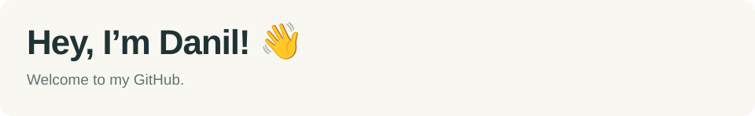
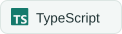
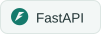
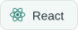
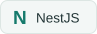
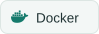

<picture>
  <source media="(max-width: 600px) and (prefers-color-scheme: dark)" srcset="assets/header-dark-mobile.svg">
  <source media="(max-width: 600px)" srcset="assets/header-light-mobile.svg">
  <source media="(prefers-color-scheme: dark)" srcset="assets/header-dark.svg">
  
</picture>

I’m a software engineer in **Ottawa, Canada**. I build backend services and web apps, and mostly write **Python** and **TypeScript**.

I studied Computer Science at **Carleton University**, with a minor in Statistics. When I’m not coding, I like going for a run, flying FPV drones, or playing chess.

### Tools I use

Here are some of the languages, frameworks, and tools I’ve worked with:

  <picture><source media="(prefers-color-scheme: dark)" srcset="assets/python-dark.svg"></picture>
  <picture><source media="(prefers-color-scheme: dark)" srcset="assets/typescript-dark.svg"></picture>
  <picture><source media="(prefers-color-scheme: dark)" srcset="assets/django-dark.svg"></picture>
  <picture><source media="(prefers-color-scheme: dark)" srcset="assets/fastapi-dark.svg"></picture>
  <picture><source media="(prefers-color-scheme: dark)" srcset="assets/react-dark.svg"></picture>
  <picture><source media="(prefers-color-scheme: dark)" srcset="assets/nestjs-dark.svg"></picture>
   
  <picture><source media="(prefers-color-scheme: dark)" srcset="assets/postgresql-dark.svg"></picture>
  <picture><source media="(prefers-color-scheme: dark)" srcset="assets/aws-dark.svg"></picture>
  <picture><source media="(prefers-color-scheme: dark)" srcset="assets/docker-dark.svg"></picture>
  <picture><source media="(prefers-color-scheme: dark)" srcset="assets/terraform-dark.svg"></picture>

What’s on my desk

- **Editor & shell:** VS Code · Bash
- **Computer & monitor:** Mac with M1 Pro · RD320U
- **Keyboard:** ZSA Moonlander · [my layout](https://configure.zsa.io/moonlander/layouts/n64mD/latest/0)
- **Mouse & headphones:** MX Master 3S for Mac · Sony WH-1000XM6

I’m also on [LinkedIn](https://www.linkedin.com/in/danilkuprin1/) and [LeetCode](https://leetcode.com/u/danilkuprin1/). Thanks for stopping by!

